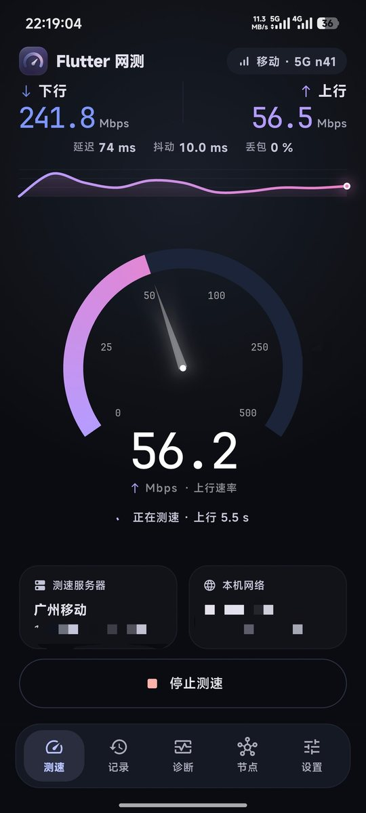
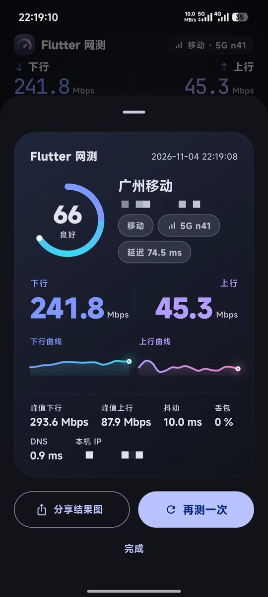
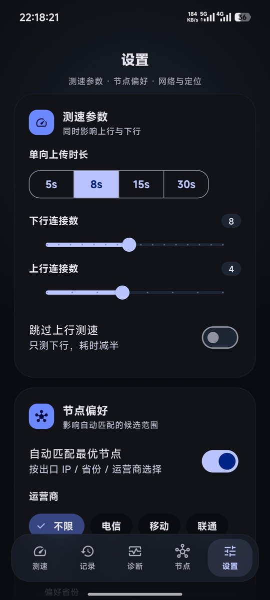

# Flutter 网测

对 CAICT「全球网测」Android 4.4.8 的公开测速协议做完整还原，用 **Flutter + Material 3 Expressive**
重写的移动端测速工具。无广告、无账号，结果只保存在本机；全局深色，仪表盘参考 Speedtest 但保留 Material 3 语言。

[](https://github.com/yssite/qqwc-flutter/releases)

| 测速中 | 结果 | 设置 |
|---|---|---|
|  |  |  |

## 亮点

- **秒开、跟手**：release 构建 AOT 编译，首帧 1 秒内出；按压、切页、仪表盘指针全部走弹簧曲线，滚动不掉帧。
- **换网不重启**：接的是系统 `ConnectivityManager` 网络回调与信号回调，Wi‑Fi ↔ 蜂窝、切数据卡、换运营商后界面**立即**跟着变；
  另保留 12 秒轮询兜底，回调漏掉也不会卡在旧状态。
- **链路信息比原版细**：`移动 · 5G n41`、`电信 · 4G B1`、`5G WiFi6`，诊断页再给出带宽与 RSRP/RSSI；
  拿不到的字段直接隐藏，不会显示 `0` 或 `--` 糊弄。
- **双卡跟着数据卡走**：按当前承载流量的 subscriptionId 取信号，小区还要过一遍 PLMN / 共建共享校验，
  不会把另一张卡的频段安到这张卡上。
- **Material 3 Expressive**：动态配色、弹簧动效、悬浮半透明底栏，全局深色仪表盘，信息层级一眼可读。

## 功能

| 模块 | 说明 |
|---|---|
| 一键测速 | 自动匹配节点 → TCP 延迟 → 下行 8 连接 → 上行 4 连接 → 100 分制评分 |
| 实时仪表 | 指针仪表盘（厚渐变外环、只留数值）、实时曲线、JetBrains Mono 读数 |
| 网络标识 | `移动 · 5G n41`、`电信 · 4G B1`、`5G WiFi6`；跟随当前数据卡，切卡 12 秒内更新 |
| 定位匹配 | 授权后按定位省份选节点，运营商取数据卡（Wi‑Fi 时取出口 IP） |
| 节点库 | 内置 596 节点，搜索 / 省份 / 运营商筛选，批量测延迟 |
| 记录 | 本地持久化、详情曲线、滑动删除、CSV 导出 |
| 诊断 | 连接情况、出口 IP、TCP 延迟、DNS、多目标连通质量、日志导出 |
| 更新 | 启动自检 + 设置页检查 GitHub Release，多线程分段下载后直接拉起系统安装器 |
| 无障碍 | 仪表盘、列表行、服务器卡均带语义标签，底栏可被读屏识别 |

## 下载

到 [Releases](https://github.com/yssite/qqwc-flutter/releases) 取最新 APK，也可以装好之后在
「设置 → 检查更新」里直接下（ABI 自动匹配，分段并发下载）：

| 文件 | 适用 |
|---|---|
| `*_universal.apk` | 通用（约 53 MB），不确定选它 |
| `*_arm64-v8a.apk` | 绝大多数手机（约 19 MB） |
| `*_armeabi-v7a.apk` | 老 32 位设备（约 17 MB） |
| `*_x86_64.apk` | 模拟器 / x86 设备（约 21 MB） |

Android 7.0+；debug 签名，可直接侧载，上架需自行换签名。

## 构建

```powershell
flutter pub get
flutter run -d <device>
flutter build apk --release --split-per-abi
flutter test
```

国内镜像：

```powershell
$env:PUB_HOSTED_URL='https://pub.flutter-io.cn'
$env:FLUTTER_STORAGE_BASE_URL='https://storage.flutter-io.cn'
```

## 协议

```
token = md5( md5("model=..&imei=..") + md5("stime=..&band=..&rand=12345555") )
GET  /speed/dovalid?...        → 1-<uuid>
GET  /speed/File(1G).dl?...    ×N 连接，裸 socket 计数
POST /speed/doAnalsLoad.do     ×N 连接，multipart 无限写
POST /speed/dovalid?key=<uuid> 收尾
```

节点表是 `DES/ECB/PKCS5`、密钥 `dw!@#$%^` 的十六进制文本；pointycastle 4 移除单 DES 引擎，
这里用 3DES 引擎 + 密钥重复三次退化实现（`test/des_test.dart` 有 OpenSSL 向量校验）。

采样口径：每 500ms 采样累计字节，按真实时间戳做 1s 滑动窗口；前 2s 预热不计入，结束后丢弃末尾半窗口。

## 目录

```
lib/core/      协议常量、token、节点与 DES 编解码、运行日志
lib/engine/    测速 isolate、事件模型、控制器
lib/data/      设置与历史持久化、链路采集、省级边界兜底
lib/ui/        页面、仪表盘、结果卡、底栏
android/…/NetLink.kt   原生链路采集（连接类型 / 制式 / 频段 / 信号 / 定位 / 权限）
```

## 说明

协议来自官方 App 的公开接口，用于互操作性与学习研究；不上传任何测速结果。
测速节点 IP 均来自官方客户端内置的公开节点表。

更新记录见 [CHANGELOG.md](CHANGELOG.md)。

## 许可

[GNU General Public License v3.0](LICENSE)
