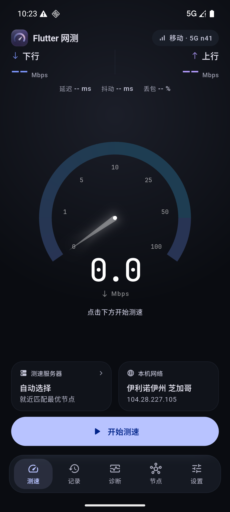
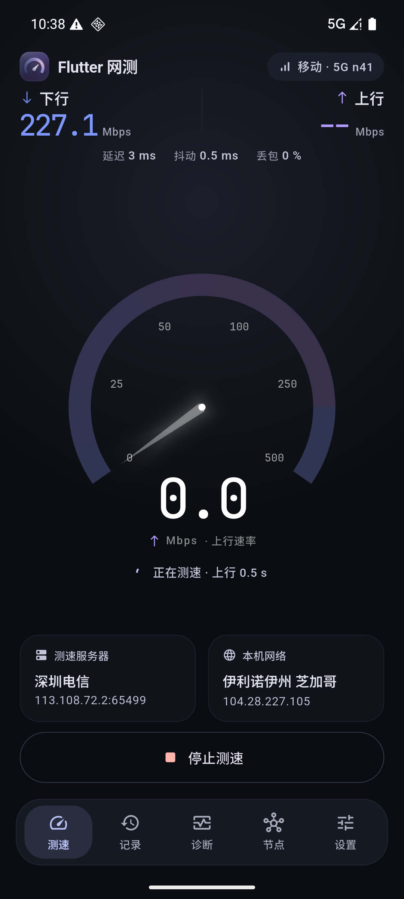
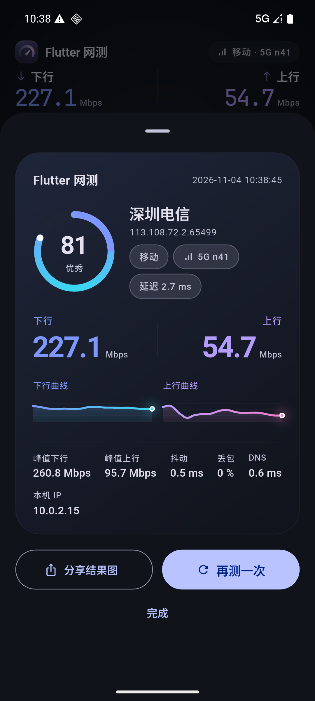
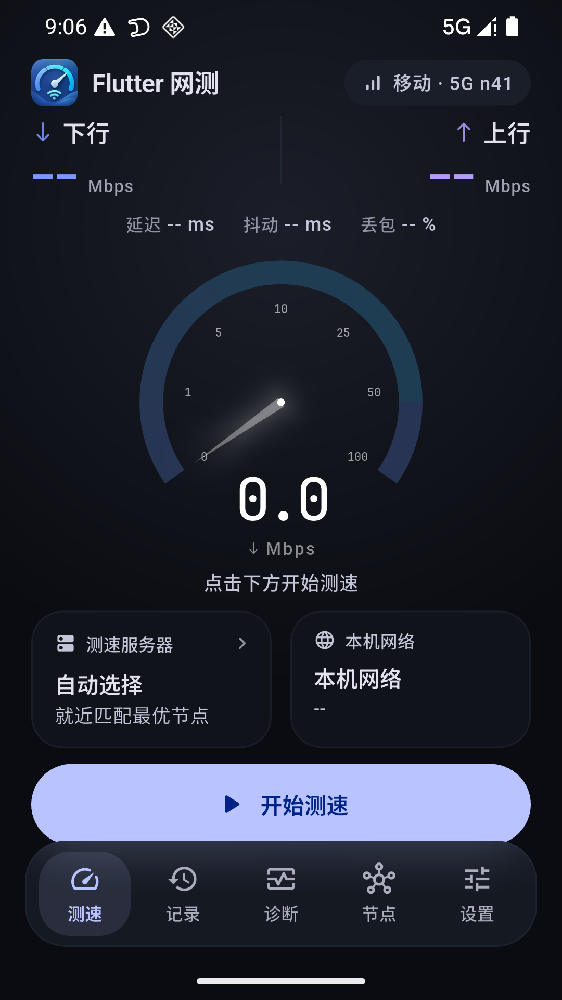
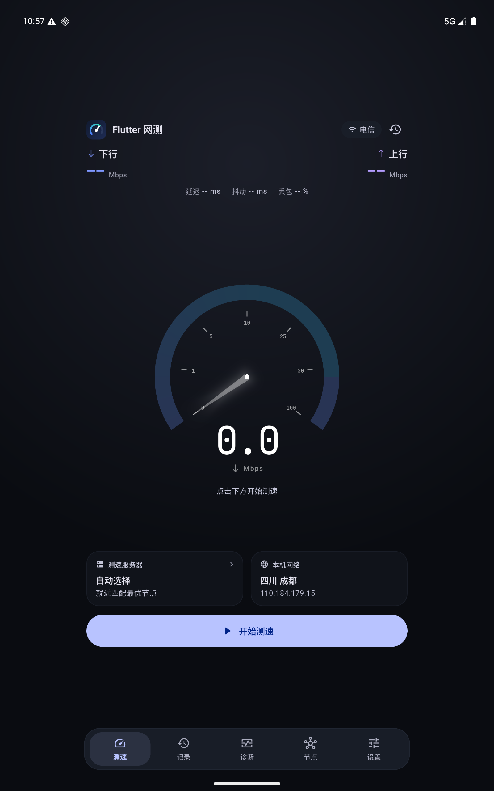
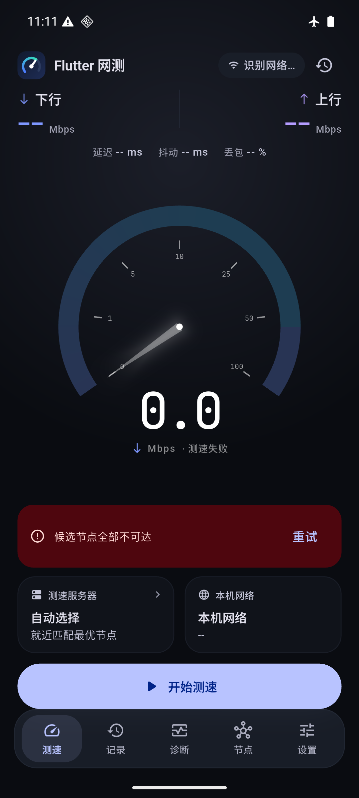
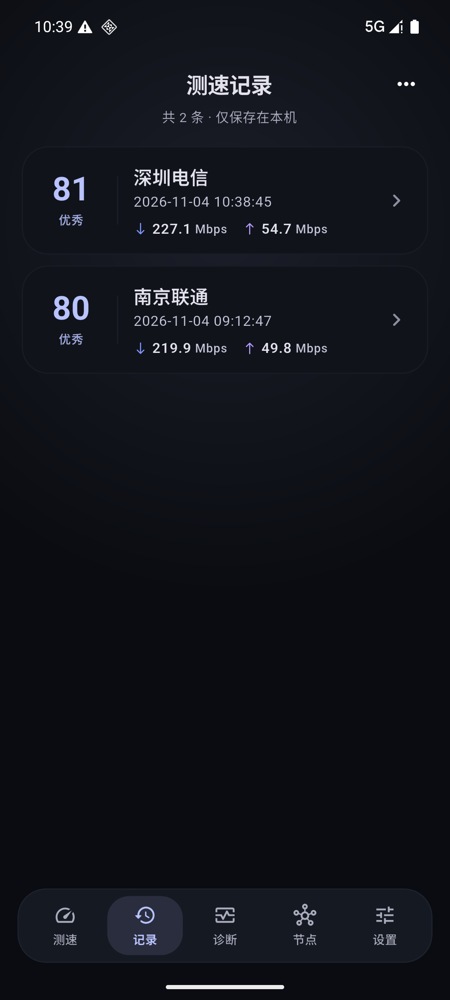
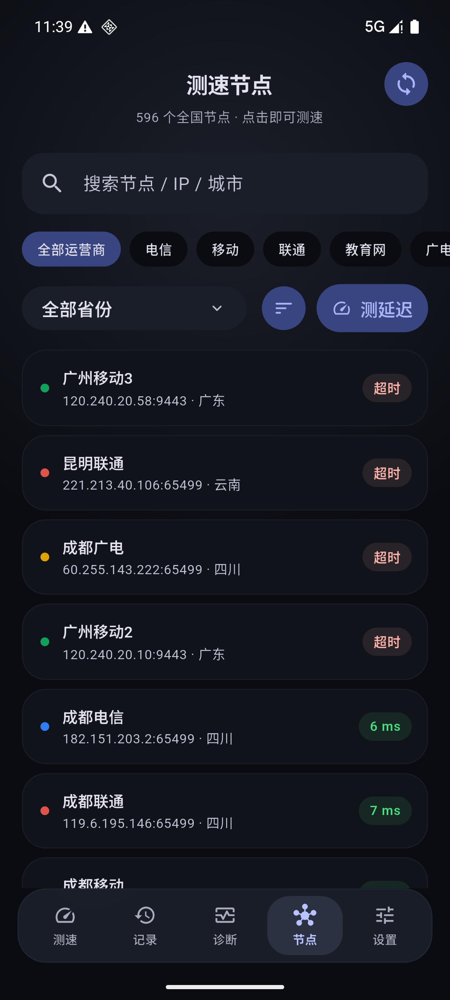
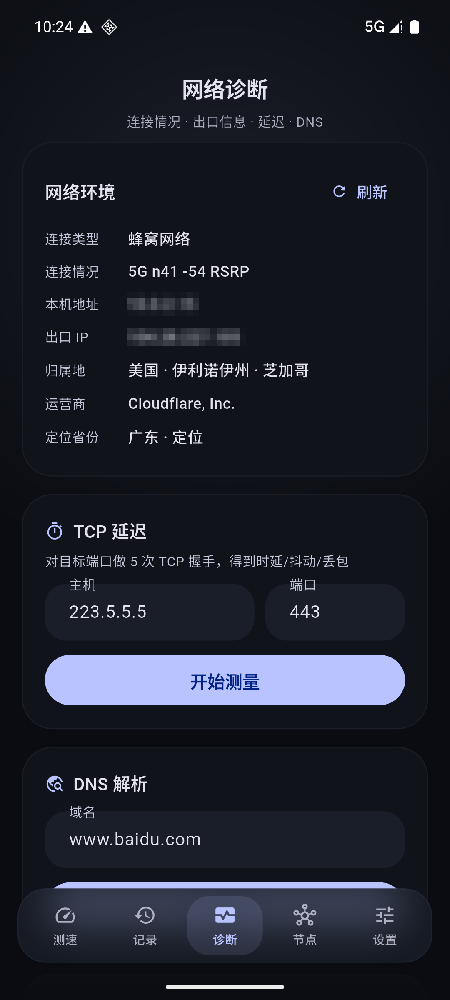
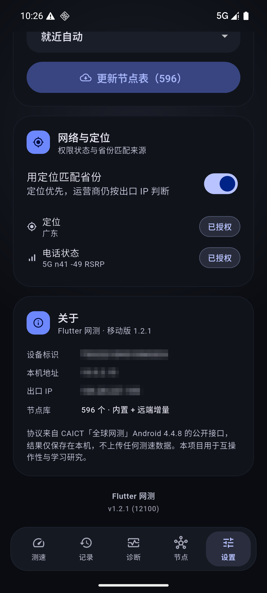

# Flutter 网测

对 CAICT「全球网测」Android 4.4.8 的公开测速协议做完整还原，并用 **Flutter + Material 3 Expressive**
重写的移动端测速工具。无广告、无账号，测速结果只保存在本机。

- 版本：1.2.1 · Android（Flutter 3.47 / Dart 3.13，targetSdk 36，minSdk 24）
- 设计：首页沿用原版 App 的信息骨架（读数 → 指标 → 曲线 → 仪表盘 → 服务器/网络 → 主按钮），
  仪表盘与读数排版参考 Speedtest 移动端，配色、圆角与动效保持 Material 3 Expressive 语言
- 主题：**全局固定深色**（测速场景下深色更少干扰，也不再维护浅色主题）
- 独立工程：本仓库不依赖任何桌面端代码

## 功能

| 模块 | 说明 |
|---|---|
| 一键测速 | 自动匹配节点 → TCP 延迟 → 下行（8 连接）→ 上行（4 连接）→ 评分 |
| 实时仪表 | 指针式仪表盘：加厚渐变外环 + 只保留数值刻度 + 锥形指针 + 等宽读数（JetBrains Mono） |
| 网络标识 | 右上角显示「运营商 · 制式频段」：`移动 · 5G n41`、`电信 · 5G WiFi6`、有线网络 |
| 链路采集 | 原生通道读取连接类型、Wi-Fi 制式/频段/带宽/信号、蜂窝制式/频段/RSRP，拿不到的字段自动隐藏 |
| 定位匹配 | 授权后优先用定位省份匹配就近节点，运营商仍按出口 IP 判断；无定位时回落 IP 归属地 |
| 曲线 | 全宽实时曲线，测速中随采样滚动 |
| 测速节点 | 内置 596 节点，搜索 / 省份 / 运营商筛选，批量测延迟 |
| 结果 | 评分环、上下行曲线、网络标签、结果长图分享（系统分享面板） |
| 历史 | 本地持久化、大号评分 + 详情曲线、滑动删除、CSV 导出 |
| 网络诊断 | 连接情况 / 出口 IP / 归属地 / 定位省份、TCP 延迟、DNS、多目标连通质量 |
| 设置 | 时长、连接数、跳过上行、节点偏好、网络与定位权限、节点表更新、版本号 |
| 无障碍 | 仪表盘读数、列表行、服务器信息均带语义标签；底栏按钮可被读屏识别 |

## 更新记录

**v1.2.1**

- 新图标：换成第三版设计稿（深紫底 + 紫粉渐变弧），重新生成自适应前景与各密度 mipmap
- 双卡修复：蜂窝信息改为绑定「当前数据卡」的 TelephonyManager，切卡后（含重启）显示的是新卡的制式/频段/信号
- 频宽补全：用 `PhysicalChannelConfig` 读取下行带宽，4G 与 Wi-Fi 的频宽照常展示；5G 拿不到时整段隐藏
- Wi-Fi 带宽新增扫描结果兜底（按 BSSID 匹配 `ScanResult.channelWidth`）
- 移除浅色主题：全局固定深色，设置页去掉外观选项
- 新增 `test/link_test.dart`：覆盖 4G/5G/WiFi 文案、权限映射、版本号与省级边界兜底

**v1.2.0**

- 新图标：改用 AI 生成的设计稿，裁掉外圈投影后生成自适应图标前景与各密度 mipmap
- 首页右上角改为链路标识（运营商 + 5G n41 / 5G WiFi6 等），移除重复的历史入口
- 新增定位 / 电话状态权限申请，先说明用途再弹系统授权，可在设置里随时补授权
- 定位优先匹配省份（运营商仍按出口 IP），诊断页与设置页显示定位来源与结果
- 诊断页新增「连接类型 / 连接情况」，5G 频宽拿不到时整段隐藏
- 结果卡与记录详情加入简略网络标签，测试时写入记录
- 仪表盘去掉刻度短线，数值放大并贴合外环
- 底部导航改为悬浮 + 由下往上的渐隐遮罩，内容从胶囊下方透出
- 首页改用 spaceBetween 布局：小屏 / 高 DPI（9:16）下可正常下滑，按钮不再被挤没
- 历史列表只保留上下行两项，修复右侧溢出

## 截图

| 首页 | 测速中 | 结果 |
|---|---|---|
|  |  |  |

| 360dp 小屏 | 800dp 平板 | 离线报错 |
|---|---|---|
|  |  |  |

| 记录 | 节点 | 诊断 | 设置 |
|---|---|---|---|
|  |  |  |  |

## 构建

```powershell
flutter pub get
flutter run -d <device>
flutter build apk --release            # build/app/outputs/flutter-apk/
flutter build apk --release --split-per-abi
flutter test                           # token / DES / 评分 / 序列化 / 链路文案
```

国内镜像：

```powershell
$env:PUB_HOSTED_URL='https://pub.flutter-io.cn'
$env:FLUTTER_STORAGE_BASE_URL='https://storage.flutter-io.cn'
```

## 架构

```
lib/
├─ core/        protocol.dart（token / dovalid / 请求路径）· node.dart（节点 + DES 解密）
├─ engine/      engine_isolate.dart（独立 isolate 跑完整测速链路）· engine_controller.dart
├─ data/        store.dart（设置 / 历史 / 出口信息）
├─ theme/       app_theme.dart（M3 Expressive 配色 · 排版 · 弹簧曲线）
├─ ui/          shell.dart · pages/* · widgets/*
├─ app_state.dart
└─ main.dart
```

测速全部在独立 isolate 中执行：匹配 → RTT → 会话 → 多线程传输 → 采样 → 评分，
主线程只接收事件并渲染，采样期间不掉帧。

### 采样口径

```
每 500ms 采样累计字节
speed = (total(t) - total(t-1s)) * 8 / span / 1e6      // 真实时间戳 1s 滑动窗口
前 2s 标记预热，不参与统计
结束后去掉末尾半个窗口的采样再求平均
```

## 协议

```
token = md5( md5("model=..&imei=..") + md5("stime=..&band=..&rand=12345555") )
GET  /speed/dovalid?key=&flag=true&bandwidth=200&model=Android&imei=TS..&time=..&app=globalspeed&token=..&pkg=..
  → 1-<uuid>
GET  /speed/File(1G).dl?r=<unix>&key=<uuid>      ×N 连接，裸 socket 计数
POST /speed/doAnalsLoad.do                        ×N 连接，multipart 无限写
POST /speed/dovalid?key=<uuid>                    收尾
```

节点表为 `DES/ECB/PKCS5`、密钥 `dw!@#$%^` 的十六进制文本；pointycastle 4 移除单 DES 引擎，
这里用 3DES 引擎 + 密钥重复三次退化实现，结果与 Java `DesUtil` 一致（`test/des_test.dart` 有 OpenSSL 向量校验）。

## 说明

协议来自官方 App 的公开接口，用于互操作性与学习研究；不上传任何测速结果。
本仓库中的测速节点 IP 均来自官方客户端内置的公开节点表。

## 许可

[GNU General Public License v3.0](LICENSE)
