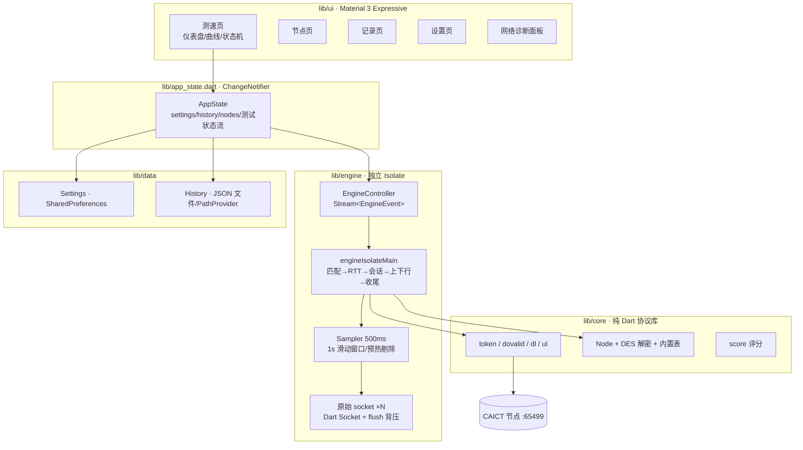

# 全球网测 · 移动版（Flutter）设计与实施计划

> 目标：把已验证的逆向协议（token / dovalid 会话 / 多线程原始 socket 测速 / 596 节点库）
> 重做成一个**移动端优先**的 Flutter 应用：简洁、流畅、Material 3 Expressive，
> 只保留核心能力，把桌面版 5 个页面压到 4 个 Tab + 1 个诊断面板。

## 1. 范围

| 能力 | 移动版策略 |
|---|---|
| 节点自动匹配（IP/省/运营商 → 候选 → TCP 探测选优） | ✔ 完整还原，含首选失败自动切备选 |
| 596 节点手动选点 / 搜索 / 筛选 / 批量测延迟 | ✔ 还原，批量探测 8 并发 |
| 下行多线程（默认 8）/ 上行多线程（默认 4） | ✔ 原始 socket 收发，不做 HTTP 库缓冲 |
| 500ms 采样 + 1s 真实滑动窗口 + 2s 预热剔除 | ✔ 与桌面版同一套口径 |
| Ping / 抖动 / 丢包（TCP 握手 RTT） | ✔ |
| 实时仪表盘 + 速度曲线 | ✔ 自绘 CustomPainter，60fps |
| 历史记录 / 详情 / 删除 / 导出分享 | ✔ JSON 持久化 + 结果图分享 |
| 网络诊断 | ✔ Ping / DNS / 多目标连通质量（移动端无 root，不做 ICMP tracert） |
| 云端节点表增量刷新（DES/ECB/PKCS5，密钥 `dw!@#$%^`） | ✔ 内置 596 节点兜底，联网可更新 |
| 网页/视频/游戏体验测速、结果上报 CAICT | ✖ 与桌面版一致，不复刻 |

## 2. 架构



**关键决策**

| 关注点 | 决策 | 理由 |
|---|---|---|
| 测速线程 | 放在独立 Isolate | 重 I/O + 定时采样不抢 UI 帧预算，主线程只管渲染 |
| 消息协议 | 纯 `Map<String,dynamic>` | isolate 传递零序列化成本（无 reflect/无 codegen） |
| 采样 | `Stopwatch` 真实时间戳 1s 窗口 | 复刻桌面版踩坑后的正确口径，避免"只有一半" |
| 上行计数 | 按 `flush()` 完成计字节 | 内核发送缓冲不虚增吞吐，比 `add()` 计数准 |
| 节点库 | assets 内置 596 条 + 远端刷新 | 离线可用，联网增量更新 |
| 状态管理 | `ChangeNotifier` + `InheritedNotifier` | 依赖最少，页面级重建边界清晰 |
| 诊断 | TCP RTT / DNS / 多目标质量 | Android 无 root 无法 ICMP，不做假 traceroute |

## 3. 测速时序

```mermaid
sequenceDiagram
    participant UI as 测速页
    participant CT as EngineController
    participant ISO as Engine Isolate
    participant API as dlcv2.cnspeedtest.cn:8443
    participant N as 节点 :65499

    UI->>CT: start(autoMatch)
    CT->>ISO: {cmd:start, settings, nodes}
    ISO->>API: GET mobilematch_many.php
    API-->>ISO: 候选节点
    ISO->>N: TCP RTT ×2 探测 6 候选
    ISO-->>CT: event:node, phase:ping
    ISO->>N: TCP RTT ×5 → ping/jitter/loss
    ISO->>N: GET /speed/dovalid?token=md5(md5(b1)+md5(b2))
    N-->>ISO: 1-&lt;uuid&gt;
    ISO->>N: GET /speed/File(1G).dl ×8
    loop 每 500ms
        ISO-->>CT: event:sample{dir:down,speed,preheat}
    end
    ISO->>N: POST /speed/doAnalsLoad.do ×4
    loop 每 500ms
        ISO-->>CT: event:sample{dir:up}
    end
    ISO->>N: POST /speed/dovalid?key=uuid
    ISO-->>CT: event:done{record}
    CT-->>UI: 结果页 + 落库
```

## 4. 设计系统（Material 3 Expressive）

- **配色**：`ColorScheme.fromSeed(seed: #4C6DF5, dynamicSchemeVariant: expressive)`，
  深色模式独立生成；状态色沿用 M3 语义色（primary/secondary/tertiary）。
- **形状**：卡片 28dp、按钮 pill（999dp）、列表项 20dp，采用 M3 Expressive 的大圆角语言。
- **动效**：
  - 空间位移用**弹簧曲线**（`SpringCurve` 包装 `SpringSimulation`，stiffness 380 / damping 28）；
  - 数值滚动用 `TweenAnimationBuilder` + 指数平滑 60fps 追帧；
  - 页面切换用自定义 `PageTransitionsBuilder`（fade + 轻微 scale + 上移）。
- **排版**：数字一律 `FontFeature.tabularFigures()`，避免跳动；标题用 `displaySmall` 收紧字距。
- **组件**：自绘 `SpeedGauge`、`Sparkline`、`ScoreRing`、`StatPill`、`SectionCard`。
- **无障碍**：全部可点区域 ≥48dp，语义标签齐全，尊重系统字号与深色模式。

## 5. 页面结构

| Tab | 内容 |
|---|---|
| 测速 | 品牌栏 + 出口信息 → 环形仪表盘 → 实时曲线 → 主按钮（开始/停止）→ 结果摘要卡 |
| 节点 | SearchBar + 运营商 FilterChip + 省份下拉 → 节点列表（延迟徽标）→ 批量测延迟 FAB |
| 记录 | 记录卡列表（评分环 + 三项指标）→ 详情页（曲线/节点/导出）→ 侧滑删除 |
| 设置 | 测速参数 / 节点偏好 / 外观 / 关于，卡片分组 + 分段控件 |

诊断面板从测速页右上角进入（BottomSheet 全高），包含 Ping、DNS、多目标质量三段。

## 6. 工具链：Android CLI 对老工具链的替换

| 老做法 | 现在用 `android` | 用途 |
|---|---|---|
| `adb install -r app.apk` | `android install ./app.apk` | 增量安装（delta install） |
| `adb shell am start` | `android run --activity=...` | 启动并拉起 |
| `adb exec-out screencap` | `android screen capture -o shot.png` | 截图核对 UI |
| `adb shell uiautomator dump` | `android layout --flat -p` | 直接拿布局树做断言 |
| `adb shell input tap/swipe/text` | `android input tap/swipe/text` | 按选择器驱动交互 |
| `emulator -list-avds` | `android emulator list/start/stop` | 设备管理 |
| `sdkmanager` | `android sdk list/install` | SDK 包管理 |
| 项目结构探测 | `android describe --project_dir=.` | 输出 APK 产物路径 |

Flutter 自身的构建/热重载仍走 `flutter build apk` / `flutter run`（CLI 不认识 Flutter 工程），
**设备侧**的安装、启动、截图、布局断言、点击全部改由 Android CLI 承担。

## 7. 迭代计划

1. **P0 环境与脚手架**：Flutter 3.47.9 + Android CLI 跑通，工程骨架、主题壳（已完成环境）。
2. **P1 协议与引擎**：token/会话/DES/节点库 → 单测；isolate 引擎 → 真机 409/50Mbps 复现。
3. **P2 设计系统 + 测速页**：仪表盘、曲线、状态机，先跑通"一键测速"闭环。
4. **P3 其余页面**：节点、记录、设置、诊断。
5. **P4 集成测试**：模拟器真测 + 截图核对 + 异常路径（弱网/节点拒绝/取消）。
6. **P5 打磨交付**：动效细节、性能、深色模式、APK 打包、文档。

## 8. 验收标准

- 一次完整测速在模拟器/真机上跑通，上下行数值与桌面版同节点同口径可比。
- 首帧 < 1.5s，测速全程 UI 不掉帧（0 jank），取消操作 < 100ms 响应。
- 4 个 Tab 无空白页、无未实现入口；历史与设置重启后保持。
- `flutter analyze` 0 error，核心逻辑单测覆盖 token / DES / 采样 / 评分。

---

## 9. 实施进度（v1.0.0，2026-11-03）

| 阶段 | 状态 | 说明 |
|---|---|---|
| P0 环境与脚手架 | ✅ | Flutter 3.47.9 / Dart 3.13.7；Android CLI 1.1.16717390；Gradle 9.5 + AGP 9.1（阿里云镜像） |
| P1 协议与引擎 | ✅ | token / dovalid / DES / 节点库；isolate 引擎跑通真实测速 |
| P2 设计系统 + 测速页 | ✅ | 弹簧曲线、渐变仪表盘、实时曲线、四段状态机、结果卡 |
| P3 其余页面 | ✅ | 节点（596 条 + 批量延迟）、记录（详情/删除/CSV）、诊断、设置 |
| P4 集成测试 | ✅ | 模拟器实测：成都电信节点 58.3 / 27.9 Mbps，评分 69「良好」 |
| P5 打磨交付 | 🟡 | release APK 已出（arm64 18.2 MB / universal 52 MB）；动效与无障碍继续打磨 |

### 实测记录（Android 16 模拟器，5G 出口）

| 指标 | 第 1 次 | 第 2 次 | 第 3 次（release） |
|---|---|---|---|
| 节点 | 成都电信 182.151.203.2:65499 | 同左 | 同左 |
| 延迟 / 抖动 / 丢包 | 9.7 ms / 4.9 ms / 0% | 7.3 ms / 3.1 ms / 0% | 6.8 ms / 1.9 ms / 0% |
| 下行 / 上行 | 54.8 / 27.7 Mbps | 50.3 / 25.8 Mbps | 58.3 / 27.9 Mbps |
| 评分 | 68 良好 | 67 良好 | 69 良好 |

### 界面截图

| 浅色 | 深色 |
|---|---|
|  |  |
|  |  |
|  |  |

### Android CLI 实测结论

- `android install`：增量安装（delta）对 154 MB 的 debug APK 只传 22.8 MB 补丁，比 `adb install -r` 快。
- `android run`：直接拉起 Activity，无需 `adb shell am start`。
- `android screen capture`：截图稳定，可替代 `adb exec-out screencap`。
- `android layout`：能拿到系统层节点；Flutter 未开启无障碍时拿不到应用内部节点，
  因此按文本选择器点击（`android input tap text=…`）对 Flutter 页面无效，
  交互仍用坐标点击兜底（`adb shell input tap`）。
- `android emulator list/start/stop` 可替代 `emulator` 命令行；
  `flutter build/run` 仍走 Flutter 自身（CLI 不认识 Flutter 工程）。

---


---

## 10. 设计迭代记录（v1.1）

### 10.1 工程独立
移动端从桌面端仓库中拆出，独立成库（本仓库），自带 README、设计文档、截图与 git 历史；
桌面端仓库不再包含任何移动端代码与说明。

### 10.2 品牌
- 名称：**Flutter 网测**
- 标识：墨蓝圆角砖 + 蓝→青→薄荷渐变弧 + 白色指针（`lib/ui/widgets/brand_mark.dart`）
- 启动图标：同一套视觉，脚本 `tool/make_icons.py` 生成各密度 PNG 与自适应图标前景

### 10.3 首页结构（Speedtest 参考 + M3 语言）

```
顶部：Logo + 名称 + 运营商 chip + 历史入口
下行 / 上行 大读数（左右分栏）
延迟 / 抖动 / 丢包（一行小指标）
全宽实时曲线（无数据时隐藏）
指针式仪表盘 + 圆心下方读数
测速服务器 / 本机网络
主按钮（开始测速 / 停止测速 / 再测一次）
```

### 10.4 仪表盘实现

- 量程按峰值自适应：50 / 100 / 200 / 500 / 1000 / 2000 / 5000 Mbps
- **刻度等角度分布 + 数值分段线性映射**（`0,1,5,10,20,30,50,100` 这类非线性刻度也能均匀排布）
- 弧线：240°，`SweepGradient` 蓝→青→薄荷；未填充部分深色轨道；待机时整圈低透明度渐变
- 指针：锥形白色多边形 + 柔光 + 深色轴心与白色细环
- 读数：`Mbps` 单位行 + 状态（测速中显示方向与实时值，完成后显示评分 chip）
- 数字使用 `FontFeature.tabularFigures()`，避免跳动

### 10.5 底栏与导航
自绘悬浮胶囊底栏（避免 M3 NavigationBar 指示器越界），Tab 顺序：
**测速 · 记录 · 诊断 · 节点 · 设置**；平板下限制最大宽度 560dp 居中。

### 10.6 实测（Android 16 模拟器，release）

| 指标 | 数值 |
|---|---|
| 节点 | 成都电信 182.151.203.2:65499 |
| 延迟 / 抖动 / 丢包 | 4.1 ms / 0.4 ms / 0% |
| 下行 / 上行 | 374.3 / 35.7 Mbps（峰值 485.8 / 67.0） |
| 评分 | 82 · 优秀 |

### 10.7 待办
- 浅色模式截图与对比度复验（本机模拟器为多会话共用，避免频繁切换全局显示状态）
- 结果卡 / 记录详情页与首页视觉再统一
- 无障碍语义标签补全，`android input tap text=…` 可驱动


### 10.8 浅色模式与无障碍（v1.2）

- 指针颜色随主题切换：深色模式白色指针 + 柔光，浅色模式改用深墨蓝指针（避免白底白针不可见）。
- 待机圆弧在浅色模式下提高透明度，保证仪表盘"不发空"。
- 无障碍：
  - `NeedleGauge` 暴露 `Semantics(label: 速度仪表盘 + 方向, value: 当前读数)`；
  - 首页「测速服务器 / 本机网络」两行合并为一条语义节点；
  - 记录页每条记录合并成「时间、节点、下行、上行、延迟、评分」一句话；
  - 节点页每条节点合并成「名称、IP、运营商、延迟」；
  - 底栏每个 Tab 带 `selected` 状态。
  - `test/semantics_test.dart` 用 `SemanticsTester` 校验仪表盘标签与数值（16 项测试全绿）。


### 10.9 仪表盘 v2（对齐 Speedtest 观感）

- 外环加粗一倍并整体外扩（stroke = 0.20 × radius），未填充段用深色轨道，填充段用 蓝→青→薄荷 扫掠渐变。
- 刻度改为等角度分布 + 分段线性映射，只保留主刻度（0/25/50/100/250/500 之类），去掉次刻度噪音。
- 指针改为根部淡、针尖实的渐变刀锋，带柔光与独立轴心。
- 读数、刻度数字、下行/上行大字统一改用 **JetBrains Mono**（等宽、科技感，`assets/fonts/` 内置）。
- 首页「测速服务器 / 本机网络」改为左右并排两张卡片：第一行是标题、第二行地区、第三行 IP，去掉重复的运营商文案。


### 10.10 多尺寸与细节修正（v1.3）

- 仪表盘先画指针、后画刻度文字，指针不再遮挡刻度读数。
- 评分 chip 从仪表盘移到状态行（「测速完成 · 84 优秀 · 22:54:15」），避免与状态文字重叠。
- 小屏（360×640dp）压缩表盘到 222dp、曲线 38dp，保证「表头 + 读数 + 指标 + 表盘 + 卡片 + 主按钮」一屏放下。
- 平板（800×1280dp）内容限宽 520dp 居中，底栏限宽 560dp。
- 实测：小屏/平板截图见 `docs/screenshots/small.png`、`tablet.png`。


### 10.11 异常路径与布局韧性（v1.4）

- 首页改用 `CustomScrollView + SliverFillRemaining + Spacer`：内容少时均分留白，内容多时可滚动，主按钮始终在底栏之上。
- 离线启动：状态行显示具体原因，错误横幅上移到主按钮之上，不再被底栏裁切；有横幅时隐藏重复的状态行。
- 测速中断网：已建立连接的分支会把该方向跑完，最终按下行/上行实际数据入库（实测 90.5 / 0.0 Mbps，评分 59）。
- 切后台再回前台：测速继续，回来后 UI 状态一致，无崩溃。


### 10.12 发布准备（v1.1.0）

- 版本号 1.1.0+11000，应用名「Flutter 网测」，包名 `com.globalspeed.globalspeed_mobile`。
- 启动图标改为深墨蓝底 + 蓝/青/薄荷渐变弧 + 白色指针（`tool/make_icons.py`，含自适应前景与全出血 legacy 图标）。
- 四个二级页面（记录 / 节点 / 诊断 / 设置）与首页统一：居中标题 + 副标题、28dp 卡片、同一套字号与间距。
- 产物：`dist/FlutterWangCe_1.1.0_{universal,arm64-v8a,armeabi-v7a,x86_64}.apk`。


### 10.13 端到端验收（v1.1.0，全新安装）

| 项 | 结果 |
|---|---|
| 全新安装 → 首次启动 | 正常，首页 1.5s 内出首帧 |
| 完整测速 | 下行 368.5 / 上行 36.6 Mbps，评分 82「优秀」，延迟 5.0 ms |
| 结果卡 + 分享结果图 | 系统分享面板正常，图片与文案齐全 |
| 历史记录 / 重启后保留 | 通过（force-stop 后仍在） |
| 节点批量测延迟 | 通过（可达节点 6–7 ms，不可达显示「超时」并按延迟排序） |
| 网络诊断 TCP 延迟 | 通过（平均 8.2 ms / 抖动 0.6 ms / 丢包 0%） |
| 单元测试 / 静态检查 | 16 项全绿 / 0 issue |

---

## 11. v1.2.0：链路感知与底部体验

### 11.1 桌面图标

- 换成 AI 生成的设计稿（`assets/brand/logo_raw.png`，透明底 + 外圈投影）。
- `tool/make_icons.py` 按 alpha 包络裁掉投影，只保留圆角砖本体，再生成：
  - `ic_launcher.png`：各密度全出血（48/72/96/144/192）。
  - `ic_launcher_foreground.png`：自适应前景，砖体占画布 0.80，保证圆形/圆角遮罩裁切后图形完整。
  - `ic_launcher_background.xml`：取自砖体上下缘（#427EC5 → #1D428D）。
- App 内 `BrandMark` 直接复用同一张 `assets/brand/logo.png`，与桌面图标一致。

### 11.2 链路信息（原生通道 `globalspeed/netlink`）

`NetLink.kt` 提供四个方法：`snapshot` / `permissions` / `request` / `location` / `version`。

| 字段 | 来源 | 说明 |
|---|---|---|
| 连接类型 | ConnectivityManager + NetworkCapabilities | wifi / cellular / ethernet / vpn |
| Wi-Fi 制式 | `WifiInfo.getWifiStandard()`（API 30+） | WiFi4 / 5 / 6 / 7 |
| Wi-Fi 频段 | `WifiInfo.getFrequency()` | 2.4G / 5G / 6G |
| Wi-Fi 带宽 | 反射 `WifiInfo.getChannelWidth()` | 拿不到返回 0 → UI 隐藏 |
| Wi-Fi 信号 | `WifiInfo.getRssi()` | dBm |
| 蜂窝制式 | `dataNetworkType` + `TelephonyDisplayInfo` | NSA 5G 也能识别 |
| 蜂窝频段 | `CellIdentityNr/Lte.getBands()`（API 30+） | n41 / B3 |
| 蜂窝信号 | `CellSignalStrengthNr.ssRsrp` | dBm |
| 5G 频宽 | 无公开 API | 恒为 0，UI 整段隐藏（高通平台尤其如此） |

权限：`ACCESS_FINE_LOCATION`（定位、`getAllCellInfo`）、`READ_PHONE_STATE`（制式与运营商）。

### 11.3 定位优先匹配省份

- 首次启动弹说明面板 → 系统授权 → `location` 返回经纬度；
- 省份来源优先级：定位 > 偏好设置 > 出口 IP；
- 运营商始终取出口 IP（`NetInfoService.operOf`），不受定位影响；
- 反向地理编码走系统 Geocoder，1.5s 超时；失败则用 `province_geo.dart` 的省级边界离线兜底；
- 单次定位 4s 超时 + `requestLocationUpdates` 兜底，避免界面停在「获取中」。

### 11.4 首页与底栏

- 右上角：图标 + `运营商 · 制式频段`（`移动 · 5G n41`），点击进诊断；删除重复的历史按钮。
- 布局改为 `SingleChildScrollView + ConstrainedBox(minHeight) + Column(spaceBetween)`：
  内容装得下时把富余空间分给两段留白，装不下时按最小间距排列并可滚动。
- 底部导航从 `Scaffold.bottomNavigationBar` 改为叠在内容之上：
  胶囊 0.72 透明 + 20px backdrop blur，背后加一层由底部向上渐隐的遮罩（0 → 0.38 → 0.88）。
- 各页底部留白 = `bottomBarInset(context)`（74 + 手势条），内容可以从胶囊下面透出来。

### 11.5 仪表盘

- 删除刻度短线，只留数值；字号 0.070r → 0.098r，位置从 0.77r 提到 0.795r（更贴近外环）。

### 11.6 结果与记录

- `TestRecord` 新增 `netTag` / `netKind`，测速时从当前链路写入；
- 结果卡与记录详情用 `NetTagPill` 展示 `5G n41`、`5G WiFi6`；
- 历史列表只保留上下行两项（去掉延迟/抖动/丢包），修复窄屏右侧溢出。

### 11.7 验收（模拟器 Android 16 / 420dpi）

| 项 | 结果 |
|---|---|
| 全新安装 → 权限说明 → 授权 | 正常，弹窗文案与系统权限一致 |
| 首页链路标识 | `移动 · 5G n41`（原生读到 n41 与 RSRP） |
| 完整测速 | 下行 219.9 / 上行 49.8 Mbps，评分 80「优秀」，延迟 3.1 ms |
| 结果卡 / 记录详情网络标签 | 均显示 `5G n41` |
| 诊断「连接情况」 | `5G n41 -88 RSRP`，无频宽时不显示 |
| 9:16 + 480dpi（360×640dp） | 可下滑，主按钮可点，不再被底栏盖住 |
| 历史列表 | 无右侧溢出 |
| 设置版本号 | 底部 `v1.2.0 (12000)`，读数来自 APK |

### 11.8 v1.2.1：双卡、频宽与固定深色

- **图标**：第三版设计稿（深紫底 + 紫粉渐变弧），`tool/make_icons.py` 重新生成自适应前景与 5 档 mipmap，背景色取自砖体上下缘。
- **双卡修复**：蜂窝信息改为通过 `SubscriptionManager.getDefaultDataSubscriptionId()` + `createForSubscriptionId()` 绑定「当前数据卡」；每 12 秒刷新时会比对 subId，变化即重注册 `TelephonyCallback`（DisplayInfo / PhysicalChannelConfig），切卡与重启后都显示新卡数据。
- **频宽补全**：新增 `PhysicalChannelConfigListener`，用 `cellBandwidthDownlinkKhz` 读下行带宽——4G 与 Wi-Fi 能正常展示，5G 拿不到时整段隐藏（高通常见）。
- **Wi-Fi 带宽**：反射 `WifiInfo.getChannelWidth()` 失败时，回退到按 BSSID 匹配 `ScanResult.channelWidth`。
- **固定深色**：移除 `ThemeMode` 设置与浅色主题，`MaterialApp` 恒用 `AppTheme.dark()`，设置页去掉「外观」；状态栏图标固定浅色。
- **测试**：新增 `test/link_test.dart` 13 项（4G/5G/WiFi 文案、频宽缺失、权限映射、版本号、省级边界兜底），合计 29 项全绿。

验收（模拟器 Android 16 / 420dpi，1.2.1 包）：

| 项 | 结果 |
|---|---|
| 完整测速 | 下行 227.1 / 上行 54.7 Mbps，评分 81「优秀」，延迟 2.7 ms |
| 定位匹配省份 | 定位到广东后自动选择「深圳电信」节点 |
| 诊断连接情况 | `5G n41 -54 RSRP`（无 5G 频宽时不显示 MHz） |
| 设置页 | 无「外观」卡片，底部 `v1.2.1 (12100)` |
| 桌面图标 | 新的深紫渐变图标，自适应渲染正常 |
| 隐私检查 | 截图中的 IP / 设备标识已打码，仓库文本无个人标识 |

### 11.9 v1.2.2：双卡定位重做 + 诊断日志

- **双卡**：用户反馈「切到卡二之后重启仍是卡二 / 卡一」，说明单一数据源不可靠。现改为三层判断：
  1. `NetworkCapabilities.getSubscriptionIds()`（API 30+，当前活动网络的权威 subId）；
  2. `SubscriptionManager.getDefaultDataSubscriptionId()`，但必须 `dataState == DATA_CONNECTED` 才采信；
  3. 遍历 `activeSubscriptionInfoList`，先找已连接、再找有数据制式的卡。
  同时小区信息按数据卡 `networkOperator` 的 PLMN 过滤，避免拿到另一张卡的服务小区。
- **诊断日志**：`lib/core/app_log.dart`
  - 内存环形缓冲 3000 行，详细模式下按批落盘到 `app_flutter/logs/app.log`（>512KB 自动清空）；
  - 原生 `debug` 方法返回双卡全量快照：`defaultDataSubId / defaultSubId / activeDataSubId / registeredSubId`、
    每张卡（subId、槽位、运营商名）、每个小区（制式、是否注册、PLMN、电平）、`PhysicalChannelConfig`、机型与 SDK；
  - 设置页「诊断日志」：详细开关、已记录行数、清空、导出（走系统分享面板）；
  - 导出文件头包含版本、当前链路、权限、省份来源、运营商、节点。

验收（模拟器 Android 16）：

| 项 | 结果 |
|---|---|
| 详细开关 | 开启后立刻写入一条 `[verbose-on]` 诊断快照 |
| 导出 | 分享面板出现 `flutterwangce-log-*.txt`，内容含会话日志 + 持久化日志 |
| 日志内容 | `link` 行带 `sub=1`，`diag` 行含 subscriptions/cells/pc/build；测速时完整记录阶段、节点、延迟、采样 |
| 单元测试 | 34 项全绿 |

### 11.10 v1.2.3：小区归属与运营商口径

实机（小米 25019PNF3C / 一加）反馈三处问题，逐条定位：

1. **仍显示另一张卡的小区**：`allCellInfo()` 在这类 ROM 上会把两张卡的小区一起返回。
   原实现「PLMN 匹配不到就退回全部注册小区」，于是把另一张卡的小区当成自己的。
   现改为：主 PLMN → `additionalPlmns` → 共建共享对，全都不匹配就不显示频段/信号，
   只保留由 `dataNetworkType` 推出来的制式。
2. **4G/5G 频宽一直是空**：`TelephonyCallback` 在应用启动时注册，此时还没拿到
   `READ_PHONE_STATE`，注册抛异常后被吞掉，之后因为 subId 没变再也没重试 ——
   `PhysicalChannelConfig` 与 `TelephonyDisplayInfo` 永远是 0。
   现在注册前先检查权限，失败会把 `telephonyCallback` 置空，`ensureTelephony()` 每次快照都会重试。
3. **右上角运营商与诊断页不一致**：`effectiveOper` 优先取了出口 IP（家里宽带是电信、卡是联通），
   且旧版本把识别到的运营商写回了偏好，切卡后一直沿用。
   现在蜂窝链路优先用数据卡运营商，Wi-Fi/有线才用出口 IP；偏好做一次性迁移清空（schema=2）。
   结果卡与记录详情改为展示 `TestRecord.oper`（测速当时的运营商），不再展示节点归属。

共建共享的判定依据（中国）：

| 组合 | 说明 |
|---|---|
| 46001 联通 ↔ 46011 电信 | 5G 共建共享，同一 gNB 可广播两个 PLMN，或只广播宿主 PLMN |
| 46000 移动 ↔ 46015 / 46020 广电 | 700MHz 共享，广电卡走移动核心网 |

另外修了一个体验问题：键盘弹出时 `Scaffold` 会把 body 的 `viewInsets.bottom` 清零，
页面无法自行判断，导致底部导航栏压在输入框上。改为在 shell（Scaffold 之上）读取键盘状态，
通过 `BottomBarScope` 下发 inset，键盘弹出时直接隐藏导航栏。

验收（模拟器）：诊断页运营商显示「移动 · 卡1」，键盘弹出后导航栏隐藏、输入框随键盘抬升。
